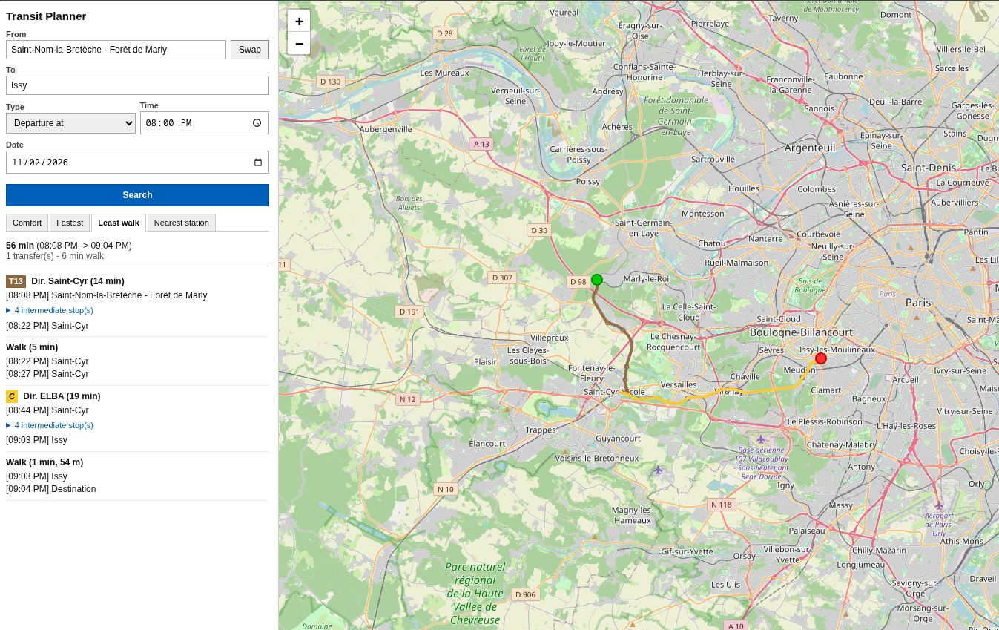

# Octara Maps

The best navigation maps for the IDFM network. (for now only the transit engine is implemented)

## Features

- [x] Custom made journey planner engine
- [x] Api
- [x] Small website to use the journey planner engine
- [ ] Implementation of OpenStreetMap data (indoor and outdoor planning)
- [~] Android app for maximum usability and style x)
    - [x] Map
    - [x] Stop search
    - [x] Next departures
    - [x] Stop Info
    - [x] Journey planner
    - [ ] Journey navigation
    - [ ] Fix bugs
    - [x] Be perfect (always)

## Use

To test the engine, you can use the small website provided in the repository : https://omaps-calc.orionhost.app/

